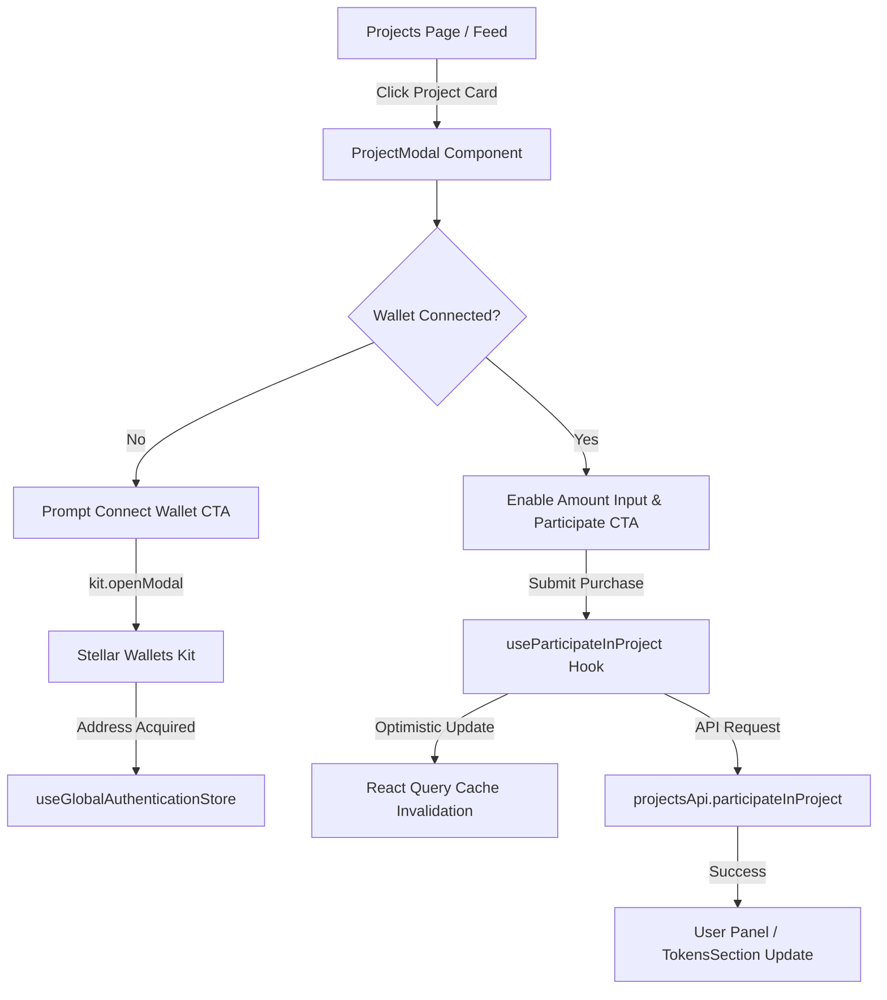

# Frontend Integration: Project Tokenization & Purchase Flow

This document details the end-to-end frontend integration for project tokenization, token purchasing, user ownership reflection, and wallet verification in the TreeByte web application.

---

## 1. Architectural Overview

TreeByte connects real-world reforestation projects in Costa Rica to verifiable digital assets minted on the Stellar blockchain (Soroban contracts). The frontend enables users to:
1. Discover active conservation and reforestation projects.
2. Inspect project capacity, annual impact, and tokenomics.
3. Authenticate with Stellar-compatible wallets (`@creit.tech/stellar-wallets-kit`).
4. Purchase and participate in project tokens.
5. Track acquired tokens and ecological footprint in the user dashboard.



---

## 2. Project Listing UI Integration

### Core Components
* **Listing Container:** Located at [`@/components/projects/project-cards.tsx`](@/components/projects/project-cards.tsx).
* **Data Fetching Hook:** [`@/hooks/projects/use-projects.ts`](@/hooks/projects/use-projects.ts) using `@tanstack/react-query`.
* **API Service:** [`@/services/api/projects-api.ts`](@/services/api/projects-api.ts).

### Data Ingestion Pattern
Projects are fetched via TanStack Query with caching, background revalidation, and filtering:

```typescript
import { useQuery } from "@tanstack/react-query";
import { queryKeys } from "@/lib/query/query-keys";
import { projectsApi, type EnhancedProject } from "@/services/api/projects-api";

export function useProjects(filters?: ProjectFilters) {
  return useQuery({
    queryKey: queryKeys.projects.list(filters),
    queryFn: () => projectsApi.getProjects(filters),
    staleTime: 5 * 60 * 1000,
  });
}
```

Project cards display key metrics:
* Species and project location
* Supply & token capacity
* Annual CO2 / environmental impact

---

## 3. Purchase Component Logic & API Calls

### Interactive Modal & Participation Guard
Token purchasing is orchestrated inside [`@/components/projects/project-modal.tsx`](@/components/projects/project-modal.tsx).

1. **User Input:**
   The user specifies the token quantity to adopt (`participationAmount`).
2. **Mutation Execution:**
   The component triggers `participateInProject.mutate({ projectId, amount })`.

```typescript
import { useParticipateInProject } from "@/hooks/projects/use-project-mutations";

export default function ProjectModal({ project, isOpen, onClose }: ProjectModalProps) {
  const [participationAmount, setParticipationAmount] = useState<number>(1);
  const participateInProject = useParticipateInProject();

  const handleParticipate = () => {
    if (participationAmount > 0) {
      participateInProject.mutate({
        projectId: project.id,
        amount: participationAmount,
      });
    }
  };
  // ...
}
```

### Mutation Flow & Cache Sync
[`@/hooks/projects/use-project-mutations.ts`](@/hooks/projects/use-project-mutations.ts) utilizes optimistic UI updates and cache invalidation:

```typescript
export function useParticipateInProject() {
  const queryClient = useQueryClient();

  return useMutation({
    mutationFn: ({ projectId, amount }: { projectId: string; amount: number }) =>
      projectsApi.participateInProject(projectId, amount),
    onSuccess: (data, { projectId }) => {
      queryClient.invalidateQueries({ queryKey: queryKeys.projects.detail(projectId) });
      queryClient.invalidateQueries({ queryKey: queryKeys.projects.userParticipation() });
      toast.success("Successfully participated in project!");
    },
    onError: () => {
      toast.error("Failed to participate in project");
    },
  });
}
```

---

## 4. Wallet Connection Checks & Guards

To prevent unauthorized transactions and failed API requests, purchase actions require an active Stellar wallet connection.

### Verification Implementation
* **Global Auth Store:** [`@/data/slices/authentication.slide.ts`](@/data/slices/authentication.slide.ts) stores `address` and `name` persisted in localStorage.
* **Wallet Kit Hook:** [`@/hooks/use-wallet.hook.ts`](@/hooks/use-wallet.hook.ts) coordinates `@creit.tech/stellar-wallets-kit`.

### Component Guard Pattern
Inside [`@/components/projects/project-modal.tsx`](@/components/projects/project-modal.tsx):

```typescript
import { useGlobalAuthenticationStore } from "@/data";
import { useWallet } from "@/hooks/use-wallet.hook";

const address = useGlobalAuthenticationStore((state) => state.address);
const { handleConnect } = useWallet();
const isWalletConnected = Boolean(address && address.trim().length > 0);

// In JSX:
{!isWalletConnected ? (
  <Alert className="mb-4 border-amber-200 bg-amber-50 dark:bg-amber-950/30">
    <AlertDescription className="flex items-center justify-between text-xs">
      <span>You must connect your wallet before you can purchase tokens.</span>
      <Button size="sm" onClick={handleConnect}>Connect Wallet</Button>
    </AlertDescription>
  </Alert>
) : null}

<Input
  disabled={!isWalletConnected}
  placeholder={isWalletConnected ? "Enter token amount" : "Connect wallet first"}
/>
```

---

## 5. Token Ownership in User Dashboard

Once tokens are acquired, they are reflected in the user's personal panel:
* **Token Balance Showcase:** [`@/components/dashboard/tokens-section.tsx`](@/components/dashboard/tokens-section.tsx) displays latest acquired species tokens (`CAOBA`, `ALMENDRO`, `SAUCE LLORÓN`, etc.).
* **Active Projects:** [`@/components/dashboard/active-projects-card.tsx`](@/components/dashboard/active-projects-card.tsx) summarizes current contributions and annual offsets.
* **Coupons & Rewards:** [`@/components/coupons/coupon-card.tsx`](@/components/coupons/coupon-card.tsx) enables holders to redeem partner perks generated from holding tree tokens.

---

## 6. Error Handling & Recovery

1. **Network Errors:**
   Centralized through [`@/hooks/use-error-handler.ts`](@/hooks/use-error-handler.ts) with user-facing Sonner toasts (`toast.error(...)`).
2. **Crash Resilience:**
   Wrapped in [`@/components/error-boundary.tsx`](@/components/error-boundary.tsx) to prevent full-app unmounting on malformed metadata or third-party wallet crashes.
3. **Optimistic Rollback:**
   React Query mutations maintain snapshots of previous state and revert automatically if backend verification fails.
